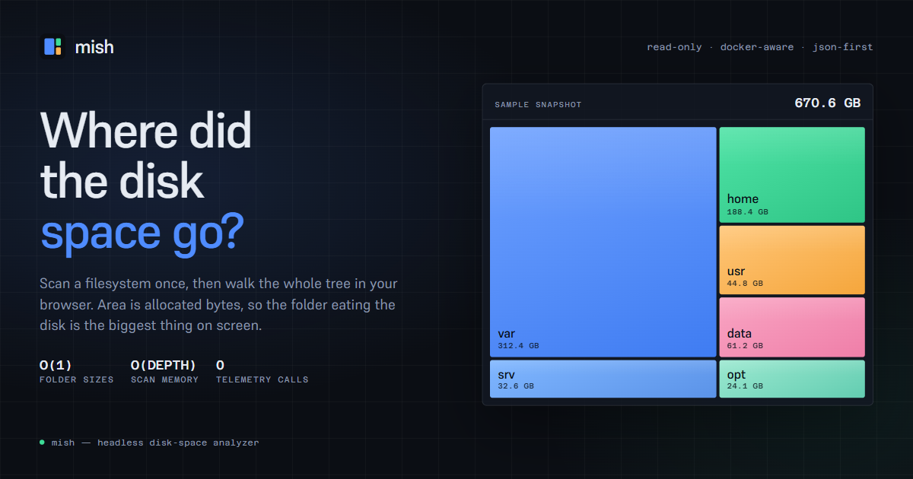
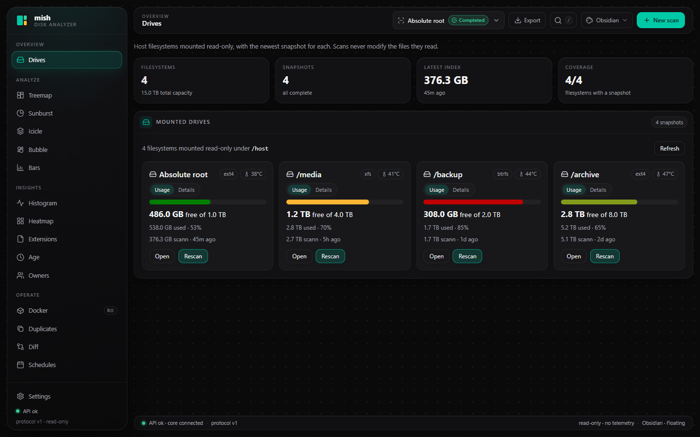
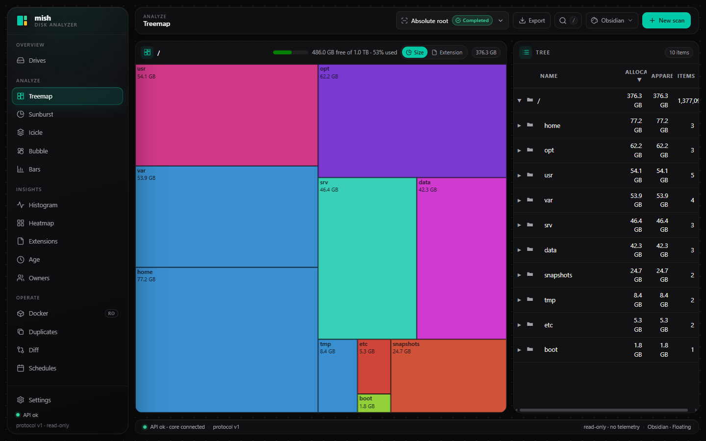
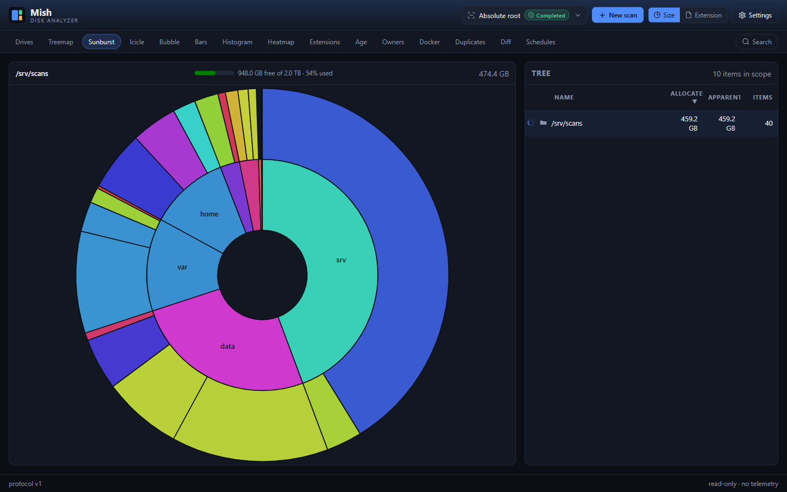
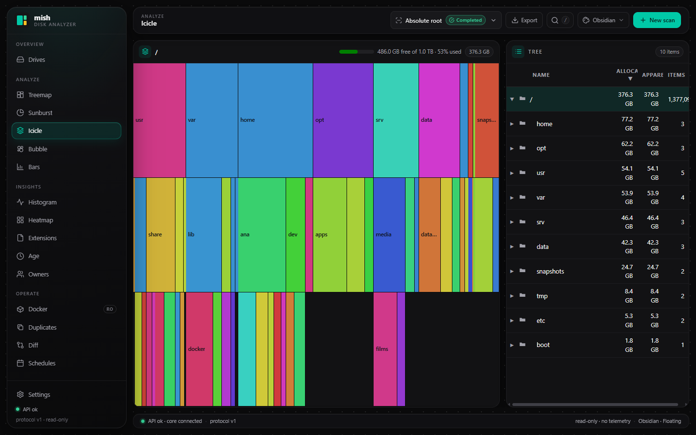
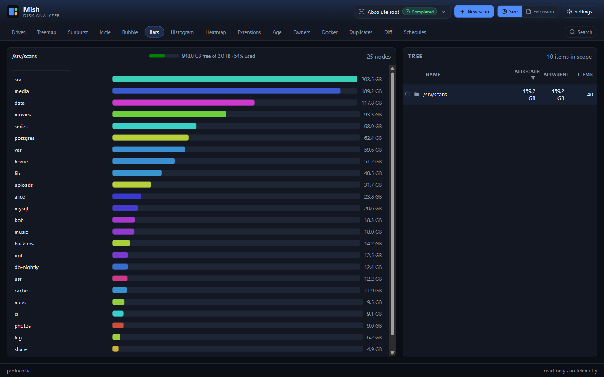
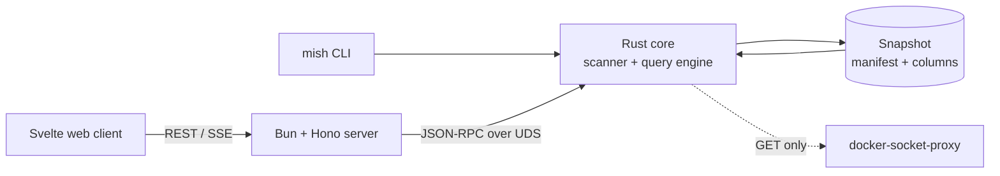

<div align="center">


# mish

**Where did the disk space go?**

Scan a filesystem once, then explore it as an interactive treemap in your browser.
Read-only, Docker-aware, JSON-first, and built for servers.

[](LICENSE)
[](CHANGELOG.md)
[](#requirements)
[](#quick-start)
[](#security-model)
[](https://github.com/Roobyx/mish/stargazers)

</div>



mish is a headless disk-space analyzer for the machines you do not sit in front of. A Rust
scanner walks the tree in pre-order and streams fixed-size node records to disk, so memory tracks
depth rather than file count. The result is an immutable snapshot that a small daemon serves over a
Unix socket and a Svelte web client renders as a treemap, sunburst, icicle, bubble chart or ranked
list. Folder totals are one column read, not a recursive query — and nothing in the scanned tree is
ever written to.

It is the WinDirStat experience for a server, without the desktop session, and without
Diskover's Elasticsearch-shaped RAM bill.

## Contents

- [Why mish](#why-mish)
- [Screenshots](#screenshots)
- [Features](#features)
- [Quick start](#quick-start)
- [Configuration](#configuration)
- [CLI](#cli)
- [Architecture](#architecture)
- [Docker integration](#docker-integration)
- [Security model](#security-model)
- [Development](#development)
- [Documentation](#documentation)
- [Project status](#project-status)
- [Contributing](#contributing)
- [License](#license)

## Why mish

- **Built for remote machines.** One container serves the UI, the API and the scanner. No VNC, no
  desktop app, no X forwarding.
- **Bounded memory.** The scanner keeps O(depth) state plus a hardlink set. Snapshots are flat
  columns read through `mmap`; the server never loads a tree into RAM.
- **Fast where it matters.** On Linux the scanner reuses the `statx` data a directory entry already
  carries. Everything else falls back to a portable path.
- **Safe by construction.** Scanned files are opened read-only. Docker is reached through a GET-only
  socket proxy. There is no delete, move or chmod anywhere in the product.
- **Scriptable first.** Every CLI command speaks JSON, the daemon speaks versioned JSON-RPC, and the
  REST API mirrors both. The web client is a consumer, not a privileged layer.

## Screenshots

| Drives | Treemap |
|---|---|
|  |  |

| Sunburst | Icicle |
|---|---|
|  |  |



> Screenshots use a synthetic demo dataset, not a real host.

## Features

**Scanning and index**

- Streaming pre-order scanner with hardlink dedup, sparse and mount flags, exclusions, and
  per-entry error reporting.
- Immutable snapshots: a manifest, fixed-size node records, concatenated names, and a subtree-size
  column. Versioned format.
- Incremental scans, one-filesystem mode, symlink following, thread control, allocated or apparent
  size.
- Scheduled scans and snapshot retention (`gc --keep N`).

**Web client**

- **Drives** dashboard: one card per host filesystem with used/free space, filesystem type, and the
  newest snapshot's size and age.
- Treemap, sunburst, icicle, bubble, ranked bars, size histogram, heatmap, and extension/age/owner
  breakdowns — all coupled to one selection.
- Drill-down with breadcrumbs, a full-snapshot tree panel, and URL-encoded view state.
- Search, duplicate candidates, snapshot diff, CSV/JSON export, and a Docker panel with live stats.
- Colour by extension or size, with labelled mount and container overlays.

**CLI, API and integration**

- JSON-first CLI, an interactive `tui`, and a UDS JSON-RPC daemon.
- REST/SSE API under `/api/v1` with camelCase wire types generated from the Rust IPC contract.
- Read-only Docker sizes, mounts and stats through a GET-only proxy.
- An agent Skill with reference docs and helper scripts in [`skills/mish/`](skills/mish/).

## Quick start

Docker Compose is the supported path. It builds the Rust core, the API server, the web client and
the docs site, mounts the host filesystem read-only at `/host`, and starts a GET-only Docker socket
proxy.

```bash
git clone https://github.com/Roobyx/mish.git
cd mish
docker compose up -d --build
```

| Service | URL | Purpose |
| --- | --- | --- |
| `mish` | <http://localhost:9543> | API + web client (bundles the Rust core) |
| `mish-site` | <http://localhost:3300> | Landing page and documentation |

The app port is published on loopback only. Because the container itself binds `0.0.0.0:9543`, the
server generates an API token on first start. Read it and paste it into the web client when asked:

```bash
docker compose exec mish cat /data/auth-token
```

Then open the Drives dashboard and scan `/host`. That path is the host root, mounted read-only.
To narrow the scope, set `HOST_MOUNT` to a specific host directory (it is always mounted at
`/host`); additional bind mounts are listed in `MISH_ROOTS` by their container paths.

### Requirements

- Linux is the primary target and has the fast path. The portable scanner builds on macOS and
  Windows; the Linux path is the tuned one.
- Docker Engine with Compose v2 for the stack.
- Root, or `CAP_DAC_READ_SEARCH`, for a full-filesystem scan. The compose stack grants exactly that
  one capability.

### LAN access

Publishing beyond loopback requires a token and an explicit Host allowlist:

```bash
MISH_PUBLISH_ADDR=0.0.0.0 \
MISH_BIND=0.0.0.0:9543 \
MISH_AUTH_TOKEN="$(openssl rand -hex 32)" \
MISH_ALLOWED_HOSTS=mish.lan \
docker compose up -d
```

Put TLS in front of it (Traefik, Caddy, Nginx) and set `MISH_TRUST_PROXY=true` only when a
trusted proxy sets the forwarding headers.

## Configuration

| Variable | Default | Purpose |
| --- | --- | --- |
| `MISH_DATA_DIR` | `./data` | Catalog, snapshots and journal |
| `MISH_BIND` | `127.0.0.1:9543` | Server bind address; non-loopback requires a token |
| `MISH_AUTH_TOKEN` | — | Bearer token for the API; auto-generated off-loopback |
| `MISH_ALLOWED_HOSTS` | `localhost,127.0.0.1,[::1]` | Accepted `Host` headers (DNS-rebinding guard) |
| `MISH_TRUST_PROXY` | `false` | Trust `X-Forwarded-*` from a reverse proxy |
| `MISH_ROOTS` | — | Canonical allowlist of scannable roots; empty rejects scans |
| `MISH_DOCKER` | `false` | Enable the Docker collector and routes |
| `MISH_CORE_SOCKET` | `/tmp/mish.sock` | Unix socket for the core daemon |
| `MISH_CORE_BIN` | — | `mish` binary the server supervises |
| `MISH_WEB_DIR` | — | Built web client to serve |
| `MISH_DOCKER_SOCKET` | `$DOCKER_HOST` or `/var/run/docker.sock` | Docker endpoint |
| `MISH_MAX_SSE` | `32` | Concurrent SSE progress streams |
| `MISH_MAX_BODY_BYTES` | `1048576` | Maximum JSON request body |

Compose-specific variables (`MISH_PORT`, `MISH_SITE_PORT`, `HOST_MOUNT`,
`MISH_PUBLISH_ADDR`, `MISH_TAG`) are documented in
[`deploy/compose/.env.example`](deploy/compose/.env.example). Limits are enforced in both the
server and the core: 32 roots, 128 exclusions, 4 concurrent scans, depth 32, 10k query results and a
100k export cap.

## CLI

The `mish` binary works standalone — no daemon needed for a one-shot scan — and every command
accepts `--json`.

```bash
# Scan a path and write a snapshot
mish scan /var --data-dir ./data --json

# Browse the result
mish top /var -n 25 --metric alloc --json
mish find /var --size +1G --mtime -180d --json
mish diff <older-snapshot> <newer-snapshot> --json

# Terminal UI
mish tui --data-dir ./data

# Daemon for the API server
mish daemon --socket /tmp/mish.sock --data-dir ./data
```

| Command | Purpose |
| --- | --- |
| `scan <path...>` | Scan and index (`--incremental`, `--one-file-system`, `--follow-symlinks`, `--exclude`, `--apparent`, `--threads`) |
| `daemon` | Unix-socket JSON-RPC server |
| `ls [path]` | List children (`--sort`, `--limit`) |
| `du [path]` | Subtree sizes (`--depth`, `--apparent`) |
| `top [path]` | Largest entries (`-n`, `--kind`, `--metric`) |
| `find [path]` | Filter by size, mtime, extension, owner or duplicate status |
| `tree [path]` | Print the hierarchy (`--depth`) |
| `tui [path]` | Browse children as sized bars |
| `ext [path]` | Extension breakdown |
| `diff <a> <b>` | Growth and shrink between snapshots |
| `docker` | Containers, sizes and mounts (`--stats`) |
| `export <snap>` | CSV or JSON export |
| `snapshots` | `list`, `delete <id>`, `gc --keep N` |
| `config` | `get`, `set <key> <value>` |
| `completions <shell>` | Shell completions |

Metrics are **allocated** (blocks consumed, the default) or **apparent** (logical size). Hardlinked
files count once in allocated totals.

## Architecture



| Component | Path | Language | Responsibility |
| --- | --- | --- | --- |
| Core library | `crates/mish-core/` | Rust | Scanner, index, query engine, Docker collector |
| CLI / daemon | `crates/mish-cli/` | Rust | `mish` binary and UDS JSON-RPC server |
| IPC contract | `crates/mish-ipc/` | Rust | Protocol types, single source of truth |
| API server | `apps/server/` | TypeScript (Bun + Hono) | REST/SSE, orchestration, scheduler, static serving |
| Web client | `apps/web/` | TypeScript (Svelte 5 + Vite) | Treemap and all visualizations |
| Docs site | `apps/site/` | Astro + Starlight | Landing page and documentation |
| Shared types | `packages/api-types/` | TypeScript | Wire types and client generated from the IPC contract |
| Agent skill | `skills/mish/` | Markdown + scripts | Skill definition and helpers |

A snapshot is a directory of four flat files, not a database:

```text
snapshots/<id>/
  manifest.json   # metadata, stats, extension table, errors
  nodes.bin       # fixed-size node records; id = pre-order index
  names.bin       # concatenated names
  subtree.bin     # u32 subtree size per node
```

Pre-order emission makes every subtree a contiguous id range, so `subtree_size` turns a folder
total into a single read. The layout is versioned (`FORMAT_VERSION`), so a format change is a
breaking change rather than a silent one.

## Docker integration

Docker support is optional and read-only. The app never mounts `docker.sock`; it talks to a proxy
that allows GET requests only.

```yaml
services:
  docker-socket-proxy:
    image: tecnativa/docker-socket-proxy:v0.5.0
    environment:
      CONTAINERS: 1
      IMAGES: 1
      VOLUMES: 1
      EVENTS: 0
      POST: 0
    volumes:
      - /var/run/docker.sock:/var/run/docker.sock:ro

  mish:
    environment:
      MISH_DOCKER: "true"
      DOCKER_HOST: tcp://docker-socket-proxy:2375
    depends_on:
      - docker-socket-proxy
```

The Docker views show container, image and volume sizes, map mounts back to snapshot nodes, and
report live CPU and memory. With `MISH_DOCKER=false` those routes return 404 and every other
view keeps working. Rootless Docker and Podman simply report the Docker views as unavailable.

## Security model

mish is designed to run on a trusted host and read broadly, often the whole filesystem through a
read-only bind mount. The network-facing API is the main boundary.

1. **Read-only toward scanned files.** Nothing is deleted, moved or modified. Snapshots are written
   only to the data directory.
2. **Docker is read-only.** GET-only proxy; the socket is never mounted into the app.
3. **Loopback by default.** A non-loopback bind requires a bearer token; if none is supplied, one is
   generated and persisted with mode `0600`.
4. **Paths are validated.** Roots are checked against the canonical `MISH_ROOTS` allowlist;
   snapshot IDs are single path components.
5. **No heavyweight index and no telemetry.** Flat columns, `mmap`, SQLite for the small catalog,
   and zero external calls at runtime.
6. **Exports are neutralized.** CSV output defuses spreadsheet formulas; filenames are treated as
   untrusted input.

The full threat model is in [`SECURITY.md`](SECURITY.md). To report a vulnerability, follow the
private disclosure process described there.

## Development

Prerequisites: Rust (pinned by `rust-toolchain.toml`), Bun, and Docker for integration tests.

```bash
# Rust workspace
cargo build --workspace
cargo test --workspace
cargo clippy --workspace --all-targets -- -D warnings
cargo fmt --all -- --check

# TypeScript workspaces
bun install
bun run build
bun run test
bun run check      # Biome + per-workspace typecheck
```

Run the pieces individually:

```bash
# Core daemon
cargo run -p mish-cli -- daemon --socket /tmp/mish.sock --data-dir ./data

# API server
MISH_ROOTS=/var/data MISH_CORE_SOCKET=/tmp/mish.sock \
  bun run --filter '@mish/server' dev

# Web client
bun run --filter '@mish/web' dev

# Docs site
bun run --filter '@mish/site' dev
```

The Dockerfiles gate the image build on the Rust and TypeScript test suites, so a broken workspace
does not produce a runtime image.

## Documentation

- In-repo docs source: [`apps/site/src/content/docs/`](apps/site/src/content/docs/) — installation,
  CLI, API, configuration, Docker, web UI, security and troubleshooting.
- Agent skill: [`skills/mish/SKILL.md`](skills/mish/SKILL.md).
- Security policy: [`SECURITY.md`](SECURITY.md).
- Contribution guidelines: [`CONTRIBUTING.md`](CONTRIBUTING.md).
- Changelog: [`CHANGELOG.md`](CHANGELOG.md).

The docs site is built and served by the compose stack at <http://localhost:3300>.

## Project status

mish was built out of personal necessity: I needed to answer "where did the disk space go?" on headless 
machines I could not sit in front of, and nothing existing fit the constraints. It will be
maintained to the best of my abilities and available time.

- **Free to use.** Anyone is free to run, modify and redistribute it under the license terms.
- **No warranty and no responsibility.** The software is provided as-is. I take no responsibility
  for how the project is used by other people, or for any consequences of that use, including data
  loss, downtime or decisions made from its output. Test it before pointing it at anything you care
  about.
- **Roadmap.** A roadmap will be published in the future.
- **Feature suggestions are welcome.** Open an issue with the problem and the use case; see
  [`CONTRIBUTING.md`](CONTRIBUTING.md).

## Contributing

The project is open to community contributions. **Bugs are prioritized before features**: a
correctness bug gets triaged and fixed before new feature work, and feature requests are read and
kept but are not commitments.

Read [`CONTRIBUTING.md`](CONTRIBUTING.md) for the bug report checklist, the development setup, the
checks to run before opening a pull request, and the coding standards. For anything larger than a
bug fix, open an issue first so the design can be agreed on before code is written. Please keep
changes read-only toward scanned files, keep the scanner streaming, and add tests for changed
behavior.

## License

GPL-3.0-or-later. See [`LICENSE`](LICENSE).
